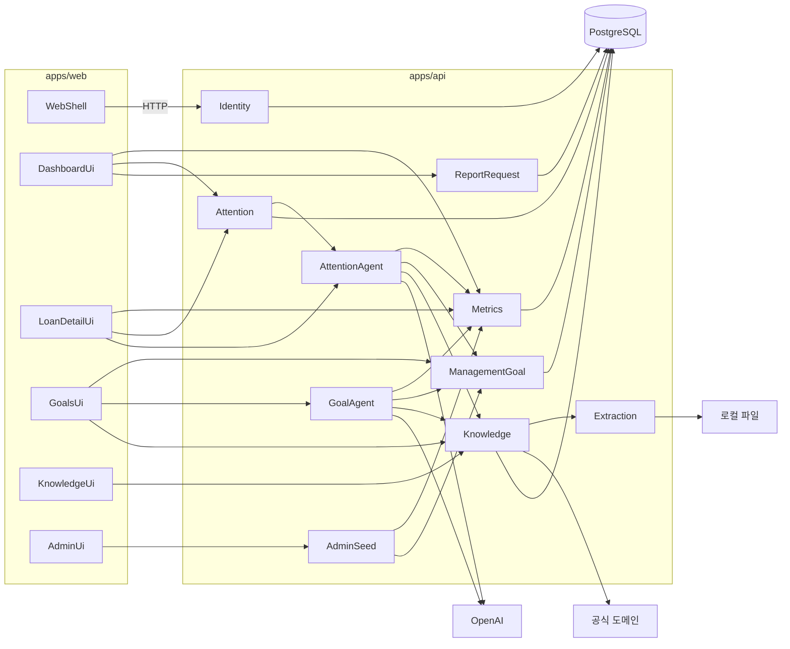

# Component Dependency

통신: 브라우저 → HTTP → `apps/api`만. OpenAI, 공식 도메인 HTTP, 로컬 파일, PostgreSQL은 API만.

---

## 의존 행렬

행이 호출하는 쪽, 열이 호출되는 쪽. `HTTP`는 Web→API. `내부`는 API 모듈 간 공개 인터페이스. `외부`는 프로세스 밖.

| | Identity | Metrics | Attention | ReportRequest | ManagementGoal | Knowledge | Extraction | AttentionAgent | GoalAgent | AdminSeed | OpenAI | OfficialSearch | Files | PostgreSQL |
|---|---|---|---|---|---|---|---|---|---|---|---|---|---|---|
| WebShell | HTTP | | | | | | | | | | | | | |
| DashboardUi | | HTTP | HTTP | HTTP | HTTP(검토 등록) | | | | | | | | | |
| LoanDetailUi | | HTTP | HTTP | | HTTP(검토) | | | HTTP(해설·추가질문) | | | | | | |
| GoalsUi | | | | | HTTP | HTTP(원문) | | | HTTP | | | | | |
| KnowledgeUi | | | | | | HTTP | | | | | | | | |
| AdminUi | | | | | | | | | | HTTP | | | | |
| DashboardQueryService | | 내부 | 내부 | 내부 | | | | 내부 | | | | | | |
| LoanDetailQueryService | | 내부 | 내부 | | | | | 내부 | | | | | | |
| GoalWorkspaceQueryService | | 내부 | | | 내부 | 내부 | | | 내부 | | | | | |
| GoalCommandService | | | | | 내부 | | | | | | | | | |
| GoalPropagationQueryService | | | | | 내부 | | | | | | | | | |
| KnowledgeCommandService | | | | | | 내부 | 내부 | | | | | | | |
| AttentionAgent | | 내부 | | | 내부(현재 목표) | 내부(정책 요약) | | | | | 외부 | | | |
| GoalAgent | | 내부 | | | 내부(목표 목록) | 내부(관련 문서·확정 기사) | | | | | 외부 | | | |
| Knowledge | | | | | | | 내부 | | | | | 외부 | 외부 | 내부 |
| Extraction | | | | | | | | | | | | | 외부 | |
| 모든 저장 모듈 | | | | | | | | | | | | | | 외부 |

---

## 통신 패턴

- **Web → API**: 동기 HTTP. LLM도 같은 요청이 끝날 때까지 대기
- **API 모듈 → 모듈**: 프로세스 내부 호출. 공개 메서드만
- **AttentionAgent / GoalAgent → OpenAI**: API 서버에서만
- **Knowledge → 공식 도메인**: 설정 목록(기본 금융위, 금감원, 기재부)
- **Knowledge → Extraction → 로컬 파일**: 업로드 경로
- **저장**: Identity, Metrics, Attention, ReportRequest, ManagementGoal, Knowledge, AdminSeed → PostgreSQL

순환 금지: Agent는 서로를 호출하지 않는다. GoalAgent는 ManagementGoal을 읽기만 하고 Command로 쓰지 않는다.

---

## 데이터 흐름

---

## 화면이 조합하는 API (F1 A)

| 화면 | 호출 |
|---|---|
| Dashboard | Attention, ReportRequest, Metrics, ManagementGoal.addReviewItem |
| Loan Detail | Metrics, Attention, AttentionAgent |
| Goals | ManagementGoal Command/Query, GoalAgent, Knowledge.getEvidence |
| Knowledge | Knowledge, Extraction(간접) |
| Admin | AdminSeed |
