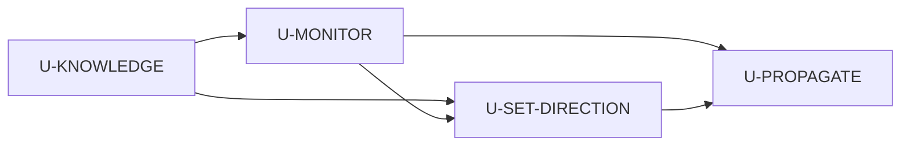

# Unit of Work Dependency

단위는 같은 모노레포의 모듈이다. 런타임은 web → HTTP → api.

---

## 행렬

행이 의존하는 쪽.

| | U-KNOWLEDGE | U-MONITOR | U-SET-DIRECTION | U-PROPAGATE |
|---|---|---|---|---|
| U-KNOWLEDGE | — | | | |
| U-MONITOR | 정책 요약·문서 시드 읽기 | — | | |
| U-SET-DIRECTION | 관련 문서·확정 기사·원문 | Metrics, 검토 등록, Shell Nav | — | |
| U-PROPAGATE | | ReportRequest 같은 저장소 | 현재 목표 레코드 | — |

순환 없음.

---

---

## 공유 모듈

| 모듈 | 쓰는 단위 | 비고 |
|---|---|---|
| Knowledge | KNOWLEDGE(쓰기), MONITOR·SET DIRECTION(읽기) | 스키마는 KNOWLEDGE가 연다 |
| ReportRequest | MONITOR list, PROPAGATE create | 같은 테이블 |
| ManagementGoal | MONITOR addReviewItem, SET DIRECTION command, PROPAGATE query | 스키마는 SET DIRECTION이 본편, MONITOR는 검토 행만 |
| Metrics | MONITOR 본편, SET DIRECTION 근거, PROPAGATE AdminSeed 쓰기 | 스키마는 MONITOR, AdminSeed는 PROPAGATE |

구현 시 스키마 마이그레이션은 그 테이블을 처음 여는 단위에 둔다: Knowledge 문서, MONITOR Identity/Metrics/Attention/ReportRequest, SET DIRECTION Goal+History, PROPAGATE는 새 테이블 없이 API·Admin만 추가할 수 있다. ReportRequest.create는 MONITOR가 연 테이블에 쓴다.
