# Execution Plan

Greenfield. Reverse Engineering 없음. 요구사항·스토리 승인됨.

- 요구사항: `aidlc-docs/inception/requirements/requirements.md`
- 스토리: `aidlc-docs/inception/user-stories/stories.md` (16개)
- 페르소나: `aidlc-docs/inception/user-stories/personas.md`
- 코드 위치: `apps/web`, `apps/api` (아직 없음). PostgreSQL, OpenAI, 로컬만

---

## Detailed Analysis Summary

### Transformation Scope (Brownfield Only)

해당 없음. 제품 애플리케이션 코드가 없는 greenfield다.

### Change Impact Assessment

- **User-facing changes**: Yes — Mock 로그인, 은행 Dashboard, 여신 상세, 경영목표 설정, 데이터베이스, 관리 화면, 한/영
- **Structural changes**: Yes — `apps/web` + `apps/api` 신규. 이후 Persona가 붙을 계정·라우팅·데이터 모델
- **Data model changes**: Yes — 실적 Mock, 경영목표, 확인·보고 요청, 문서 메타, 기사 확정, 변경 History, Persona
- **API changes**: Yes — Dashboard/목표/문서/검색/요청 생성·목표 조회 API 신규
- **NFR impact**: Yes — 로컬 실행, Resiliency(외부 실패 표시·시드 재적재), PBT 전면, Security extension 미적용. 프레임워크는 Construction NFR에서 결정 (NFR-1.2)

### Component Relationships (Brownfield Only)

해당 없음.

### Risk Assessment

- **Risk Level**: Medium — 컴포넌트가 여러 개이고 LLM·문서 파싱·공식 도메인 검색이 있다. 운영 프로덕션은 없다
- **Rollback Complexity**: Easy — 로컬 스택 재기동, Mock seed 재적재 (NFR-6.3)
- **Testing Complexity**: Complex — E2E 9단계, 목표 상태 전이, 근거 ID, PBT

### Adaptive Detail

문제 복잡도: Complex (다출처 근거, 여신 상세, 목표 수정·신규, Journey D 스키마). 실행하는 단계는 정의된 산출물을 모두 만든다. 산출물 안 상세는 이 복잡도에 맞춘다. 로컬 Prototype이므로 가용성 %·다중 리전은 요구사항대로 넣지 않는다.

---

## Workflow Visualization

```mermaid
flowchart TD
    Start(["User Request"])

    subgraph INCEPTION["🔵 INCEPTION PHASE"]
        WD["Workspace Detection<br/><b>COMPLETED</b>"]
        RE["Reverse Engineering<br/><b>SKIP</b>"]
        RA["Requirements Analysis<br/><b>COMPLETED</b>"]
        US["User Stories<br/><b>COMPLETED</b>"]
        WP["Workflow Planning<br/><b>COMPLETED</b>"]
        AD["Application Design<br/><b>EXECUTE</b>"]
        UG["Units Generation<br/>(Planning + Generation)<br/><b>EXECUTE</b>"]
    end

    subgraph CONSTRUCTION["🟢 CONSTRUCTION PHASE"]
        FD["Functional Design<br/><b>EXECUTE</b>"]
        NFRA["NFR Requirements<br/><b>EXECUTE</b>"]
        NFRD["NFR Design<br/><b>EXECUTE</b>"]
        ID["Infrastructure Design<br/><b>SKIP</b>"]
        CG["Code Generation<br/>(Planning + Generation)<br/><b>EXECUTE</b>"]
        BT["Build and Test<br/><b>EXECUTE</b>"]
    end

    subgraph OPERATIONS["🟡 OPERATIONS PHASE"]
        OPS["Operations<br/><b>PLACEHOLDER</b>"]
    end

    Start --> WD
    WD --> RE
    RE --> RA
    RA --> US
    US --> WP
    WP --> AD
    AD --> UG
    UG --> FD
    FD --> NFRA
    NFRA --> NFRD
    NFRD --> ID
    ID --> CG
    CG --> BT
    BT --> OPS
    OPS --> End(["Complete"])

    style WD fill:#4CAF50,stroke:#1B5E20,stroke-width:3px,color:#fff
    style RA fill:#4CAF50,stroke:#1B5E20,stroke-width:3px,color:#fff
    style US fill:#4CAF50,stroke:#1B5E20,stroke-width:3px,color:#fff
    style WP fill:#4CAF50,stroke:#1B5E20,stroke-width:3px,color:#fff
    style CG fill:#4CAF50,stroke:#1B5E20,stroke-width:3px,color:#fff
    style BT fill:#4CAF50,stroke:#1B5E20,stroke-width:3px,color:#fff
    style AD fill:#FFA726,stroke:#E65100,stroke-width:3px,stroke-dasharray: 5 5,color:#000
    style UG fill:#FFA726,stroke:#E65100,stroke-width:3px,stroke-dasharray: 5 5,color:#000
    style FD fill:#FFA726,stroke:#E65100,stroke-width:3px,stroke-dasharray: 5 5,color:#000
    style NFRA fill:#FFA726,stroke:#E65100,stroke-width:3px,stroke-dasharray: 5 5,color:#000
    style NFRD fill:#FFA726,stroke:#E65100,stroke-width:3px,stroke-dasharray: 5 5,color:#000
    style RE fill:#BDBDBD,stroke:#424242,stroke-width:2px,stroke-dasharray: 5 5,color:#000
    style ID fill:#BDBDBD,stroke:#424242,stroke-width:2px,stroke-dasharray: 5 5,color:#000
    style OPS fill:#BDBDBD,stroke:#424242,stroke-width:2px,stroke-dasharray: 5 5,color:#000
    style Start fill:#CE93D8,stroke:#6A1B9A,stroke-width:3px,color:#000
    style End fill:#CE93D8,stroke:#6A1B9A,stroke-width:3px,color:#000

    linkStyle default stroke:#333,stroke-width:2px
```

---

## Phases to Execute

### 🔵 INCEPTION PHASE

- [x] Workspace Detection (COMPLETED)
- [x] Reverse Engineering (SKIPPED)
  - **Rationale**: 제품 코드 없는 greenfield
- [x] Requirements Analysis (COMPLETED)
- [x] User Stories (COMPLETED)
- [x] Execution Plan (COMPLETED)
- [ ] Application Design — EXECUTE
  - **Rationale**: 웹·API·Agent·저장이 새 컴포넌트다. 책임·메서드 시그니처·서비스 오케스트레이션·의존이 아직 없다
- [ ] Units Generation — EXECUTE
  - **Rationale**: 경영목표·보고 요청·문서 스키마와 API가 신규다. `apps/web`과 `apps/api` 두 패키지. 스토리 16개를 단위에 매핑해야 한다

### 🟢 CONSTRUCTION PHASE

- [ ] Functional Design — EXECUTE
  - **Rationale**: Evidence First, 목표 상태 전이, 세 근거, 기사 확정, 여신 지표 규칙이 단위별 업무 논리로 남아 있다
- [ ] NFR Requirements — EXECUTE
  - **Rationale**: 프론트·백엔드 프레임워크가 아직 없다 (NFR-1.2). Resiliency·PBT가 켜져 있다. 이 단계에서 기술 스택을 고른다
- [ ] NFR Design — EXECUTE
  - **Rationale**: Resiliency baseline이 켜져 있다. OpenAI·공식 검색 실패 표시, 시드 재적재 패턴을 설계한다. Security extension은 꺼져 있으므로 보안 패턴은 강제하지 않는다
- [ ] Infrastructure Design — SKIP
  - **Rationale**: 클라우드 배포가 범위 밖이다 (NFR-1.1). PostgreSQL·로컬 파일 저장소는 요구사항에 이미 있다. 프로덕션 DR·CI/CD·리전은 NFR-6.5대로 배포가 범위에 들어오는 단계에서 다시 정한다
- [ ] Code Generation — EXECUTE (ALWAYS)
  - **Rationale**: 구현 계획과 코드 생성이 필요하다. 위치는 `apps/web`, `apps/api`
- [ ] Build and Test — EXECUTE (ALWAYS)
  - **Rationale**: 예제 테스트와 PBT, E2E 9단계 검증

### 🟡 OPERATIONS PHASE

- [ ] Operations — PLACEHOLDER
  - **Rationale**: 배포·운영 워크플로는 이번 Prototype 범위 밖

## Package Change Sequence (Brownfield Only)

해당 없음. 생성 순서는 Units Generation에서 `apps/web` / `apps/api` 경계를 정한 뒤에 확정한다.

## Estimated Timeline

- **Total Phases** (이 워크플로 상자): 14
- **Completed**: 4 (Workspace Detection, Requirements Analysis, User Stories, Workflow Planning)
- **Skip**: 2 (Reverse Engineering, Infrastructure Design)
- **Placeholder**: 1 (Operations)
- **Remaining EXECUTE**: 7 (Application Design, Units Generation, Functional Design, NFR Requirements, NFR Design, Code Generation, Build and Test)
- **Estimated Duration**: 달력 기간은 이 문서에서 고정하지 않는다. 남은 실행 단계 7개다

## Success Criteria

- **Primary Goal**: 종합기획부 Journey A~D Prototype. MONITOR → INTERPRET → SET DIRECTION → PROPAGATE. 요구사항 End-to-End 9단계가 데모에서 성립한다
- **Key Deliverables**: Application Design 산출물, Units, Functional Design, NFR 요구·설계, `apps/web`·`apps/api` 코드, 테스트
- **Quality Gates**: 스토리 수용 기준, IN FR 대조, NFR-3.2(확정 숫자 금지), NFR-3.3(근거 ID), PBT, 로컬에서 시드 재적재
