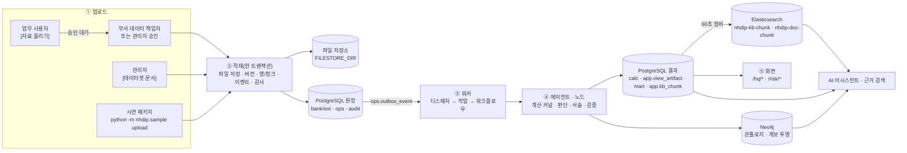
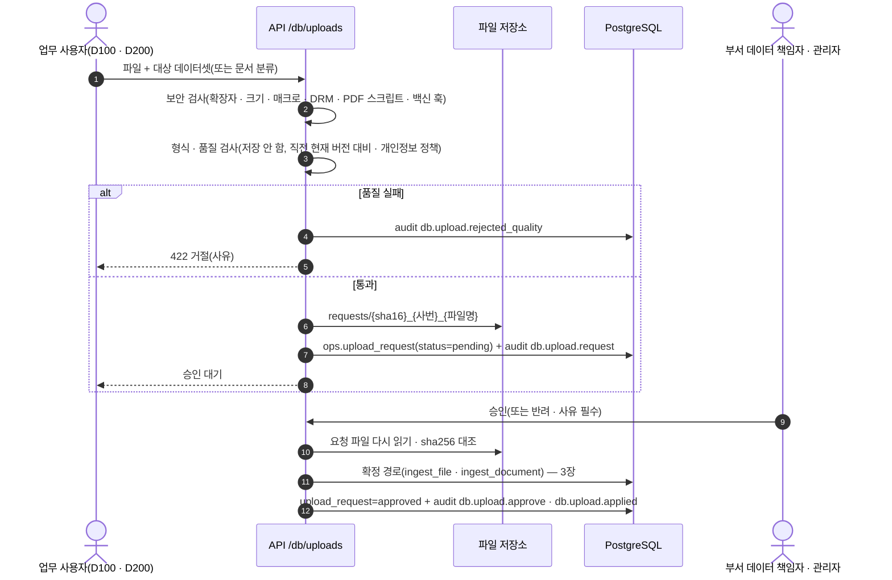
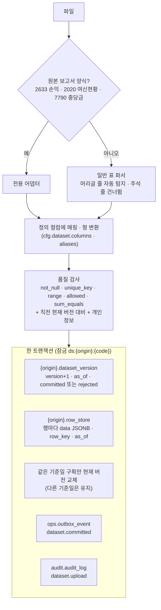
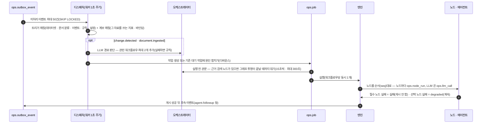
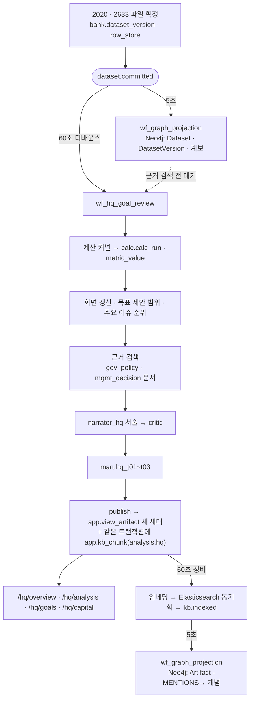
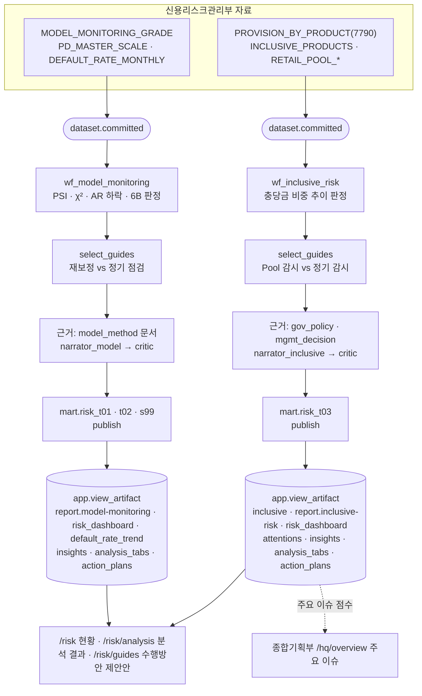
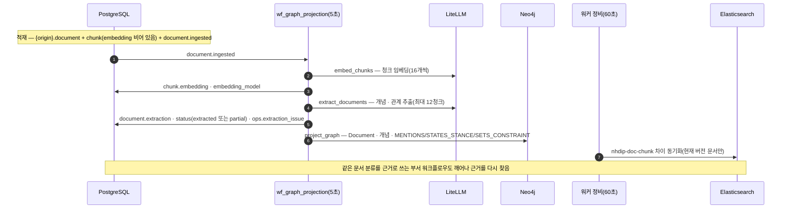
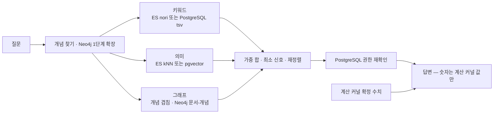

# 데이터 업로드 → 에이전트 → 저장소 흐름 (종합기획부 · 사업부서)

기준: `feat/nh-decision-platform` `f590c36`(Phase K · K.11 반영) 코드를 읽고 정리했습니다. 실행으로 확인한 범위는 2026-10-14 로컬 스택(시연 패키지 43개 업로드 → 엑셀 대조 0건 · E2E 143/143)이고, 아래 시간 값(5초 · 60초 등)은 설정 기본값입니다.

같이 보면 좋은 문서: `온톨로지_벡터_저장구조_2026-10-13.md`(색인 · 그래프 구조 상세), `에이전트_업로드시험_2026-10-11.md`(업로드 시험 판정).

---

## 0. 한눈에 보기

- 업로드 코드에는 부서 분기가 없습니다. 종합기획부(D100)와 사업부서(신용리스크관리부 D200)는 같은 업로드 경로를 탑니다.
- 부서 차이는 세 군데서 생깁니다.
  - 어떤 자료가 어떤 워크플로우를 깨우는지(트리거)
  - 그 워크플로우가 어떤 화면 산출물을 만드는지
  - 색인 컬렉션 · 화면 권한으로 누가 결과를 볼 수 있는지
- 업로드하는 순간에는 LLM 이 돌지 않습니다. 저장과 이벤트 기록만 하고, 에이전트는 워커가 이벤트를 받아 비동기로 돌립니다.
- PostgreSQL 이 원장입니다. Elasticsearch · Neo4j 는 PostgreSQL 에서 다시 만들 수 있는 색인 · 투영입니다.

---

## 1. 저장소 지도 — 어디에 무엇이 쌓이나

| 저장소 | 위치(스키마 · 이름) | 쌓이는 것 | 성격 |
|---|---|---|---|
| 파일 저장소 | `FILESTORE_DIR`(기본 `/data/files`) | 원본 파일. 데이터셋 `{origin}/{데이터셋}/{sha16}_{파일명}`, 문서 `{origin}/documents/…`, 승인 대기 `requests/…` | 원본 보관 |
| PostgreSQL `cfg` | `cfg.dataset` · `cfg.workflow` · `cfg.workflow_node` · `cfg.workflow_trigger` · `cfg.metric` · `cfg.rule` · `cfg.agent` · `cfg.prompt` · `cfg.setting` · `cfg.kb_collection` · `cfg.ontology_schema` · `cfg.secret` | 정의(데이터셋 컬럼 · 품질 규칙, 워크플로우 · 트리거, 지표 · 규칙, 에이전트 · 프롬프트, 설정, ES 연결 비밀번호(암호화)) | 관리자가 바꾸는 정의 |
| PostgreSQL `bank` · `ext` | `dataset_version` · `row_store` · `document` · `chunk` | 당행(bank) · 외부(ext) 원장. 정형 자료 행은 `row_store.data`(JSONB) 한 테이블에, 문서 본문은 `document.text`, 문서 청크는 `chunk`(pgvector `embedding` · `tsv`) | 원장 |
| PostgreSQL `ops` | `upload_request` · `outbox_event` · `job` · `workflow_run` · `node_run` · `llm_call` · `agent_decision` · `extraction_issue` · `purge_task` · `worker_heartbeat` | 승인 대기 요청, 이벤트, 작업 큐, 실행 기록, LLM 호출, 판단 근거, 추출 문제, 삭제 작업 | 운영 기록 |
| PostgreSQL `calc` | `calc_run` · `metric_value` | 계산 커널 실행(수식 · 입력 스냅샷 · 결과), 지표 값 이력 | 불변 계산 기록 |
| PostgreSQL `app` | `view_artifact` · `kb_chunk` · `user_state` | 화면 산출물(세대별 보관 · 현재 1개), 분석 결과 색인 청크(pgvector `embedding`), 사용자 처리 상태(목표 확정 · 진행사업 등록) | 화면 · 검색 |
| PostgreSQL `mart` | `hq_t01~t03` · `risk_t01~t03` · `risk_s99` · `branch_*` | 부서 컬럼 정의서 표(화면 값 대조용) | 계약 표 |
| PostgreSQL `audit` | `audit_log` | 업로드 · 승인 · 반려 · 롤백 · 삭제 감사 | 감사 |
| Elasticsearch | `nhdip-kb-chunk`(분석 결과) · `nhdip-doc-chunk`(문서 청크) | 키워드(nori + 온톨로지 사용자 사전) · 의미(dense_vector) 색인. 본문 원문은 PostgreSQL 에만 | 다시 만들 수 있는 색인 |
| Neo4j | 라벨 `Dataset` · `DatasetVersion` · `Metric` · `Workflow` · `Artifact` · `Document` · `DocClass` · `Issuer` · 개념(`PolicyTheme` · `RatingModel` · `Segment` · `Candidate` …) | 계보(데이터셋 → 지표 → 워크플로우 → 산출물), 문서 → 개념 관계(`MENTIONS` · `STATES_STANCE` · `SETS_CONSTRAINT`), 산출물 → 개념 | 다시 만들 수 있는 투영(행 값은 넣지 않음) |

벡터는 두 군데에 있습니다. 문서 청크는 `bank.chunk` · `ext.chunk`, 분석 결과 청크는 `app.kb_chunk` 입니다. 둘 다 PostgreSQL pgvector 열이고, Elasticsearch 에는 같은 벡터의 사본이 들어갑니다. 차원은 코드에 고정하지 않고 임베딩 모델(에이전트 `embedder` · LLM 프로필 `embedding`)을 따릅니다.

---

## 2. 업로드 경로 3가지

| 경로 | 누가 | API | 승인 |
|---|---|---|---|
| [자료 올리기] `/knowledge/upload` | 화면 리소스 `db_upload` 를 가진 사용자. 기본 부여는 종합기획부(D100) · 신용리스크관리부(D200) | `POST /db/uploads/dataset` · `POST /db/uploads/document` | 필요. 부서 데이터 책임자(자기 부서와 하위 조직 요청만, 본인 요청 제외) 또는 관리자 |
| 관리자 [데이터셋·문서] | 관리자 | `POST /admin/datasets/{code}/upload` · `POST /admin/documents/upload` | 없음(바로 확정) |
| 시연 패키지 | 운영자(CLI, 관리자 계정으로 로그인) | 관리자 API 와 같음 | 없음 |

[데이터베이스] 화면의 '새 버전 올리기'는 별도 API 가 아니라 `/knowledge/upload?target=<데이터셋>` 링크입니다. 결국 첫 번째 경로를 탑니다.

---

## 3. 적재 — 한 트랜잭션에 쓰는 것

### 3.1 정형 자료(엑셀 · CSV)

- 기준일(as_of)을 비우면 파일 안의 가장 늦은 기간을 씁니다. 그래서 1~12월이 든 2020 원본이나 월별 부도율 파일이 서로를 밀어내지 않습니다.
- 품질 실패는 버전을 `rejected` 로 남기고 이벤트를 내지 않습니다. 관리자는 '품질 실패여도 확정'(force)을 고를 수 있습니다.
- 데이터셋마다 물리 테이블을 만들지 않습니다. 모든 행이 `row_store` 하나에 JSONB 로 들어갑니다. 화면 계약용 `mart.*` 표는 워크플로우가 만듭니다(5장).
- 되돌리기는 같은 기준일 구획에서 지정 버전을 현재로 돌리고 `dataset.committed`(rollback:true)를 다시 냅니다.

### 3.2 문서(PDF · HWPX · TXT …)

| 단계 | 내용 |
|---|---|
| 본문 추출 | PDF 는 면별 텍스트(pypdf), HWPX/HWP 는 전체를 1면으로. OCR 은 없음(스캔 PDF 는 OCR 후 업로드) |
| 저장 | `{origin}.document`(같은 doc_code 의 이전 버전은 현재 아님), 원본은 파일 저장소 |
| 청크 | 문단 기준 700자 · 겹침 100자, 제목 번호 체계(Ⅰ. / 1. / 가. / 1) / □)로 `section_path` |
| 청크 저장 | `{origin}.chunk` — 이 시점에는 `embedding` 이 비어 있음(`tsv` 키워드 색인은 바로 생김) |
| 이벤트 | `document.ingested` + 감사 `document.upload` |

origin 은 문서 분류로 정합니다. `gov_policy`(정부정책) · `reference` 는 `ext`, `mgmt_decision`(경영 의사결정) · `model_method`(모형·방법론) · `branch_ref`(영업점 기준) 는 `bank` 입니다.

---

## 4. 이벤트 → 워커 → 워크플로우

- 디바운스: 트리거별 `debounce_sec`, 없으면 설정 `workflow.debounce_default_sec`(60초). 수동 · 일정 이벤트는 0초. 연속 업로드는 한 번의 실행으로 합쳐지고, 늦춰지는 시간은 최초 대기 시각 + 지연×5 를 넘지 않습니다.
- 재시도: 실패 작업은 30초×시도 횟수 뒤 다시(최대 3회). 죽은 워커의 작업은 하트비트로 회수합니다.
- 승인형(HITL): `orchestrator.policy.require_approval` 에 넣은 워크플로우는 자동 실행 전에 승인 대기로 멈춥니다.
- 일배치: cron 트리거(06:00 모형 모니터링, 06:10 포용금융, 06:20 종합기획부, 06:30 영업점).
- 작업이 모두 끝났는지는 `python -m nhdip.cli wait-idle` 로 확인합니다(미처리 이벤트 · 대기 · 실행 작업 0).

---

## 5. 워크플로우와 에이전트

### 5.1 어떤 자료가 어떤 워크플로우를 깨우나

| 워크플로우 | 담당 | 깨우는 자료(데이터셋 · 마스터) | 문서 · 규칙 · 기타 |
|---|---|---|---|
| `wf_hq_goal_review` 경영목표 검토 | 종합기획부 D100 | HQ_PLAN_KPI · PL_PRODUCT_SEGMENT(2633) · LOAN_BALANCE_MONTHLY(2020) · CAPITAL_CONSTRAINT · PEER_BANK_STATS · RETAIL_POOL_SUMMARY · RETAIL_POOL_MASTER | gov_policy · mgmt_decision 문서, `goal.confirmed` · `contract.changed`, 규칙 CAPITAL_FLOORS · PROPOSAL_IMPACT · GOAL_TARGETS · GOAL_REC_POLICY · ATTENTION_SCORE |
| `wf_model_monitoring` 신용평가모형 모니터링 | 사업부서 D200 | MODEL_MONITORING_GRADE · PD_MASTER_SCALE · DEFAULT_RATE_MONTHLY | model_method 문서, 규칙 MDL_PSI_BANDS · MDL_CHI_TEST · MDL_AR_DECLINE_BANDS · MDL_AR_BASELINE · MDL_MODEL_VERDICT · GUIDE_CATALOG |
| `wf_inclusive_risk` 포용금융 신용리스크 | 사업부서 D200 | PROVISION_BY_PRODUCT(7790) · RETAIL_POOL_SUMMARY · INCLUSIVE_PRODUCTS · RETAIL_POOL_MASTER | gov_policy · mgmt_decision 문서, 규칙 INC_PROVISION_SHARE_TREND · GUIDE_CATALOG |
| `wf_branch_kpi` 영업점 영업 가이드 | 영업점 | OBLG_GRD_DEF · CORP_PROSPECT · RETAIL_EXPOSURE · BRANCH_KPI_SCORE · BRANCH_BIZ_BALANCE · 마스터 3종 | branch_ref · gov_policy 문서 |
| `wf_graph_projection` 그래프 투영 · 문서 구조화 | 공통 | 모든 데이터셋 | 모든 문서 · 온톨로지 · 설정 변경, `kb.indexed`(디바운스 5초) |
| `wf_an_<토큰>` 사용자 분석 에이전트 | 그 분석 공간의 부서 | 승인 때 고른 입력 데이터셋 | 승인 때 정한 주기(선택) |

RETAIL_POOL_SUMMARY · RETAIL_POOL_MASTER 처럼 두 부서 워크플로우에 같이 걸린 자료는 한 번 올리면 두 워크플로우가 모두 돕니다. 표에 없어도 그 자료를 쓰는 지표 · 바인딩이 있으면 계보 매칭으로 함께 깨어납니다(실제 매칭 결과는 `ops.outbox_event.matched`).

### 5.2 노드 체인

```mermaid
flowchart LR
  L["입력 고정<br/>load_inputs"] --> C["계산 커널<br/>compute_metrics"]
  C --> JG["판정(규칙)<br/>judge"]
  JG --> DT["변화 감지<br/>change_detector 🤖"]
  DT --> BV["화면 갱신<br/>build_views"]
  BV --> AV["부서별 후처리"]
  AV --> PL["실행 계획<br/>planner 🤖"]
  PL --> RE["근거 검색<br/>retrieve_evidence"]
  RE --> NA["의견 서술<br/>narrator_* 🤖"]
  NA --> CR["서술 검증(규칙)<br/>critic"]
  CR --> MC["정의서 적재<br/>materialize_contracts"]
  MC --> PB["게시<br/>publish"]
```

🤖 = LLM 을 쓰는 에이전트. LLM 이 없거나 실패하면 규칙으로 대신합니다(서술은 기존 문장을 유지).

부서별 후처리(위 그림의 '부서별 후처리'):

| 워크플로우 | 후처리 노드 | 하는 일 |
|---|---|---|
| 종합기획부 | `recommend_goals` · `rank_attentions` | 목표 조정 범위(제안) 계산, 주요 이슈 순위(ATTENTION_SCORE) |
| 모형 모니터링 | `apply_segment_labels` · `sync_analysis_tabs` · `select_guides` | 세그먼트 이름, 분석 탭 심각도, 수행방안 가이드 선택(재보정 vs 정기 점검) |
| 포용금융 | `sync_analysis_tabs` · `select_guides` | 분석 탭 심각도, 수행방안 가이드 선택(Pool 감시 vs 정기 감시) |

### 5.3 에이전트 목록

| 에이전트 | 종류 | LLM | 하는 일 |
|---|---|---|---|
| `change_detector` | 판단 | 예(실패 시 규칙 CHANGE_SIGNIFICANCE) | 계산 결과 변화의 중요도(major · minor · ignore) → 변경 피드 · `change.detected` |
| `planner` | 판단 | 예(실패 시 규칙 PLANNER_POLICY) | 다시 서술할 인사이트, 추가 근거 질의, 후속 워크플로우 |
| `orchestrator` | 판단 | 예(경로 추가만, 순서는 규칙) | 이벤트에 걸 워크플로우 최대 2개 추가 |
| `narrator_hq` · `narrator_model` · `narrator_inclusive` · `narrator_branch` | 서술 | 예(실패 시 기존 문장 유지) | 의견 문장. 숫자는 직접 쓰지 않고 `[[fig:ID]]` 표식만 |
| `critic` | 검증 | 아니오 | 숫자 직접 기재 · 모르는 표식 · 인과 단정 문장 차단 |
| `embedder` | 문서 | 임베딩 | 문서 청크 · 분석 결과 청크 벡터 |
| `ontology_extractor` | 문서 | 예(실패 시 별칭 규칙 추출) | 문서 → 개념 · 관계(근거 문구가 본문에 있어야 통과) |
| `analysis_refiner` · `an_<토큰>` · `report_renderer` | 분석 에이전트 | 정제 · 동적 수행은 예, 렌더링은 아니오 | 사용자 분석 요청 정제 → 승인 → 동적 수행 → 범용 보고서 |
| `query_assistant` | AI 어시스턴트 | 예(실패 시 수치 · 근거 목록) | 질의 응답. 숫자는 계산 커널 값만 인용, 답변 숫자 대조 |

숫자는 항상 계산 커널(`calc`)이 만듭니다. LLM 은 계산하지 않고, 서술과 판단 보조만 합니다.

---

## 6. 종합기획부 업로드 예시 — 2020 여신현황 · 2633 손익

- 만들어지는 산출물: `hq_dashboard` · `loan_overview` · `comparison_view` · `capital_view` · `profitability` · `goals` · `proposals`(목표 제안) · `attentions`(주요 이슈).
- 목표를 확정하면 `goal.confirmed` + `rule.changed`(GOAL_TARGETS)가 나가고, 두 이벤트가 합쳐져 종합기획부 워크플로우가 한 번 다시 돕니다. 확정 값 자체는 `app.user_state` 에 남고, 전파 경로 트리(`/cascade/tree`)가 이 값을 반영합니다.

---

## 7. 사업부서 업로드 예시 — 모형 모니터링 · 7790 충당금

- 수행방안 제안안(`action_plans`)은 워크플로우가 만들고, 사업부서가 [등록] · [영업점 참고]를 누르면 그 상태는 `app.user_state` 에 남습니다. 종합기획부 [사업부서 진행 사업] · 전파 경로와 영업점 화면이 같은 상태를 읽습니다.
- 포용금융 결과는 종합기획부 주요 이슈(`att-inclusive-provision`) 점수에도 들어갑니다. 부서 간 연결은 이런 산출물 · 지표 공유로 생깁니다.
- 연체율은 원천 자료가 없어 계산하지 않습니다(컬럼 정의서에 '원천 추가 필요').
- 분석 결과 색인은 `analysis.risk` 컬렉션(담당 D200)으로 들어갑니다.

---

## 8. 문서 업로드 예시 — 정책 · 보고서 PDF

- LLM 이 없으면 임베딩은 건너뛰고(의미 검색만 꺼짐, 키워드 · 그래프 검색은 동작), 추출은 온톨로지 별칭 규칙으로 합니다.
- 문서 분류가 깨우는 부서 워크플로우: `gov_policy` → 종합기획부 · 포용금융 · 영업점, `mgmt_decision` → 종합기획부 · 포용금융, `model_method` → 모형 모니터링, `branch_ref` → 영업점.

---

## 9. 시간 순서 — 업로드 한 건이 화면 · 검색까지

종합기획부가 2020 파일 한 건을 승인받았을 때(기본 설정 기준):

| 시점 | 일어나는 일 | 쌓이는 곳 |
|---|---|---|
| 0초 | 승인 → 적재 트랜잭션 | 파일 저장소, `bank.dataset_version` · `row_store`, `ops.outbox_event`, `audit.audit_log` |
| ~1초 | 디스패처가 이벤트 매칭 → 작업 생성 | `ops.job`(그래프 투영 +5초, 종합기획부 +60초) |
| ~5초 | 그래프 투영 | Neo4j(Dataset · DatasetVersion · 계보) |
| ~60초 | 종합기획부 워크플로우 실행(그 사이 업로드가 더 오면 합쳐서 한 번) | `ops.workflow_run` · `node_run` · `llm_call`, `calc.*`, `mart.hq_t0x`, `app.view_artifact`, `app.kb_chunk` |
| 게시 직후 | 화면을 다시 열면 새 값 | `/screens/*` 가 `app.view_artifact` 현재 세대를 읽음 |
| 다음 정비(≤60초) | 분석 결과 청크 임베딩 → ES 동기화 → `kb.indexed` | `app.kb_chunk.embedding`, `nhdip-kb-chunk`, `cfg.setting knowledge.es_state` |
| +5초 | 그래프 재투영 | Neo4j(Artifact → 개념) |

AI 어시스턴트는 게시 직후부터 새 결과를 찾습니다. ES 동기화 전이라도 PostgreSQL 에서 동기화 표시 이후 청크를 보충해 읽기 때문입니다.

---

## 10. 검색 쪽 — 부서 데이터가 섞이지 않는 방법

부서별 테이블 · 색인을 따로 두지 않습니다. 한 테이블(`app.kb_chunk`) · 한 색인(`nhdip-kb-chunk`) 안에서 컬렉션 · 필요 리소스 · 지점 범위로 나눕니다.

| 컬렉션 | 담당 | 공유 | 공개 범위 | 들어가는 것 |
|---|---|---|---|---|
| `analysis.hq` | D100 | — | restricted | 종합기획부 산출물(hq_dashboard · goals · proposals …) |
| `analysis.risk` | D200 | — | restricted | 사업부서 산출물(risk_dashboard · analysis_tabs · insights · action_plans · 보고서) |
| `analysis.branch` | 영업점 | — | restricted | 영업점 산출물(지점 범위 `scope_key`) |
| `doc.mgmt_decision` | D100 | — | all(부서 한정 문서는 따로 막음) | 경영 의사결정 문서 |
| `doc.model_method` | D200 | D100 | restricted | 모형 · 방법론 문서 |
| `doc.gov_policy` · `doc.reference` | — | — | all | 정부정책 · 참고 문서 |
| `doc.branch_ref` | 영업점 | D100 · D200 | restricted | 영업점 기준 · 공문 |

- 사업부서 사용자는 `analysis.risk` 를 모두 보고, `analysis.hq` 는 해당 화면 리소스가 있는 청크만 봅니다. 종합기획부도 반대로 같습니다.
- ES 결과는 모두 PostgreSQL 에서 같은 권한 조건으로 다시 확인합니다(유출 방지).
- 검색은 키워드 · 의미 · 그래프 세 갈래를 가중 합으로 합칩니다(기본 convex, 설정으로 RRF).

---

## 11. 삭제하면

| 대상 | 같은 트랜잭션 | 뒤따르는 작업 |
|---|---|---|
| 데이터셋 버전 | `row_store` 행 삭제, 메타만 `status=deleted`, 현재 버전이었으면 같은 기준일 직전 버전을 현재로 | `dataset.deleted` → 관련 워크플로우 재실행, `ops.purge_task`(Neo4j DatasetVersion), 원본 파일 정리 |
| 문서 | `chunk`(pgvector 포함) · 추출 문제 삭제, 본문 · 추출 비움, 직전 버전 승격 | `document.deleted`, `ops.purge_task`(ES 문서 청크 · Neo4j Document), 원본 파일 정리 |

`ops.purge_task` 는 워커가 30초마다 처리합니다. 분석 결과 색인(`app.kb_chunk`)은 직접 지우지 않고, 워크플로우가 산출물을 다시 게시하면서 바뀝니다. 삭제는 관리자 중 '데이터 관리자'로 지정된 사람만 할 수 있습니다.

---

## 12. 시연 패키지 43개 파일 — 부서별 구성

`sample-data/202608/`(manifest 제외 43개). 데이터셋 27개 파일(19종) + 문서 16개.

| 부서 | 데이터셋(파일 수) | 문서 |
|---|---|---|
| 종합기획부 | PL_PRODUCT_SEGMENT 2633(3) · LOAN_BALANCE_MONTHLY 2020(3) · CAPITAL_CONSTRAINT(1) · HQ_PLAN_KPI(1) · PEER_BANK_STATS(1, 외부) | 경영 의사결정 7(사업계획 · 경영전략회의 · RWA 한도 · 성과평가 등) |
| 신용리스크관리부 | MODEL_MONITORING_GRADE(2) · PD_MASTER_SCALE(1) · DEFAULT_RATE_MONTHLY(1) · PROVISION_BY_PRODUCT 7790(2) · INCLUSIVE_PRODUCTS(1) · RETAIL_POOL_MASTER(1) · RETAIL_POOL_SUMMARY(3) | 모형 · 방법론 3 |
| 영업점 | BRANCH_OFFICE_MASTER · BRANCH_KPI_SCHEME · CORP_PROSPECT · OBLG_GRD_DEF · RETAIL_EXPOSURE · BRANCH_KPI_SCORE · BRANCH_BIZ_BALANCE(각 1) | 영업점 기준 · 공문 3 |
| 공통(외부) | — | 정부정책 3(금융위원회) |

부서 구분은 파일 작성 부서 기준입니다. 시연 패키지는 관리자 API 로 올리므로 승인 단계가 없습니다. 같은 파일을 다시 올리면 건너뜁니다(`--force` 면 새 버전).

---

## 13. 직접 확인하는 곳

| 보고 싶은 것 | 화면 · 명령 |
|---|---|
| 승인 대기 · 처리 결과 | [자료 올리기] 내 요청 · 부서 데이터 책임자 검토 목록, 관리자 [자료 승인] `/admin/uploads` |
| 버전 · 품질 결과 · 되돌리기 · 삭제 | 관리자 [데이터셋·문서] `/admin/datasets` |
| 이벤트 → 워크플로우 연결 | 관리자 [파이프라인] `/admin/pipeline` · [데이터 흐름] `/admin/monitor/flow`(`ops.outbox_event` · `ops.job`) |
| 노드 실행 · LLM 호출 · 판단 근거 | 관리자 [에이전트 실행] `/admin/monitor/runs`(`ops.workflow_run` · `node_run` · `llm_call`) · [에이전트 결정] `/admin/monitor/agents`(`ops.agent_decision`) |
| 계산 결과 | 관리자 [수치 모니터링] `/admin/monitor/calc`(`calc.*`) |
| 색인 · 검색 엔진 상태 | 관리자 [AI 어시스턴트 색인] `/admin/knowledge`(Elasticsearch 연결 카드 포함) |
| 그래프 | 관리자 [온톨로지] `/admin/ontology` 구성 지도 |
| 끝났는지 | `python -m nhdip.cli wait-idle` |
| 엑셀 기준값과 화면 수치 대조 | `python -m nhdip.sample verify` |

---

## 근거 코드

| 영역 | 파일 |
|---|---|
| 업로드 요청 · 승인 | `apps/api/src/nhdip/api/db_uploads.py` |
| 관리자 업로드 · 롤백 · 삭제 | `apps/api/src/nhdip/api/admin_data.py` |
| 보안 검사 | `apps/api/src/nhdip/data/filecheck.py` |
| 정형 자료 적재 | `apps/api/src/nhdip/data/datasets.py` · `data/adapters.py` |
| 문서 적재 · 청크 | `apps/api/src/nhdip/data/documents.py` |
| 원장 테이블 | `apps/api/src/nhdip/models/source.py` · `models/runtime.py` · `models/kb.py` |
| 이벤트 · 감사 | `apps/api/src/nhdip/events.py` |
| 디스패처 · 오케스트레이터 · 엔진 · 워커 | `apps/api/src/nhdip/workflow/{dispatcher,orchestrator,engine}.py` · `worker.py` |
| 노드 · 에이전트 | `apps/api/src/nhdip/workflow/{nodes,agent_nodes,analysis_nodes,llm_judge}.py` |
| 워크플로우 · 트리거 · 에이전트 정의 | `apps/api/src/nhdip/seed/{defs_data,defs_branch,defs_core,defs_knowledge}.py` |
| 색인 · 검색 · ES | `apps/api/src/nhdip/knowledge/{indexer,maintenance,elastic,search,access}.py` |
| Neo4j | `apps/api/src/nhdip/graph/{projection,extraction}.py` |
| 삭제 | `apps/api/src/nhdip/data/deletion.py` |
| 분석 에이전트 | `apps/api/src/nhdip/analysis_agents/lifecycle.py` |
